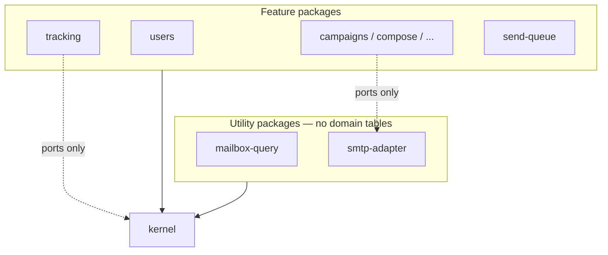
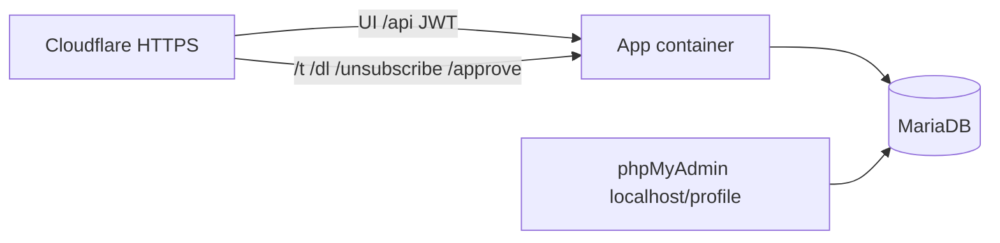

# Architecture Spine — Java list mailer

## Design Paradigm

**Feature slices + thin kernel.** Vertical packages own capability API, logic, and persistence. Features depend only on **kernel** (ports, events, conventions) — never on another feature’s internals. Layers inside a slice are allowed. Hybrid: SMTP/IMAP and similar I/O sit behind kernel ports implemented by utility/adaptor slices.



## Invariants & Rules

### AD-1 — Feature slices + thin kernel [ADOPTED]

- **Binds:** all
- **Prevents:** layered god-packages or feature→feature internals
- **Rule:** Vertical packages own capability API/logic/persistence. Features depend only on kernel (and kernel-published contracts). Hybrid OK: ports for SMTP/IMAP at kernel/slice edge; layers inside a slice allowed.

### AD-2 — Thin kernel contents [ADOPTED]

- **Binds:** all
- **Prevents:** campaign/bounce/MTS/list rules living in shared kernel
- **Rule:** Kernel holds auth/security context, bootstrap, MariaDB config, scheduler host, opaque-token helper, Parameters port, mailbox + SMTP ports, ids/clock/error/logging conventions. No campaign/bounce/MTS/list business rules. Cross-slice via kernel ports/events only.

### AD-3 — Cross-slice collaboration [ADOPTED]

- **Binds:** all
- **Prevents:** feature→feature package imports
- **Rule:** Sync queries/commands via kernel ports (owning slice implements). Noteworthy facts as domain events. No feature→feature package imports.

### AD-4 — Operator UI API [ADOPTED]

- **Binds:** R1–R34 operator surfaces
- **Prevents:** server-rendered UI or BFF drift
- **Rule:** React SPA over HTTP JSON API. Feature slices own their `/api` routes in one Spring Boot app. No BFF for V1.

### AD-5 — Domain events in-process [ADOPTED]

- **Binds:** all
- **Prevents:** external broker assumption in V1
- **Rule:** V1 domain events are in-process only (Spring `ApplicationEvent` or equivalent).

### AD-6 — Operator auth vs member tokens [ADOPTED]

- **Binds:** R1, R14, R15, R24, R34
- **Prevents:** JWT on pixel/unsub/consent; HMAC-as-session for operators
- **Rule:** Operator API: JWT Bearer (stateless) after email + password, and TOTP when the user is enrolled **or** Parameters “MFA mandatory” is on. TOTP (authenticator apps) with hashed backup codes; MFA secrets never in Parameters. Member/public links: opaque tokens (AD-18), distinct mechanism. No SMS/WebAuthn/SSO in V1.

### AD-7 — Compose topology [ADOPTED]

- **Binds:** C2
- **Prevents:** MariaDB embedded in app image; phpMyAdmin on public edge
- **Rule:** Docker Compose: **app** (+schedulers), **MariaDB**, **phpMyAdmin**. App image does not embed MariaDB. phpMyAdmin: private-only — `127.0.0.1` bind and/or Compose profile `tools`; not on Cloudflare public hostname/tunnel; SSH tunnel for remote.

### AD-8 — Schema migrations [ADOPTED]

- **Binds:** all persistence
- **Prevents:** Hibernate ddl-auto drift; ad-hoc phpMyAdmin schema as source of truth
- **Rule:** Flyway versioned SQL on app startup. Hibernate `ddl-auto=validate` or `none`.

### AD-9 — React in jar [ADOPTED]

- **Binds:** C3, operator UI
- **Prevents:** separate FE container for V1
- **Rule:** React SPA built into Spring Boot static resources. API under `/api`; SPA fallback to `index.html` for non-API routes.

### AD-10 — Single app instance [ADOPTED]

- **Binds:** schedulers, send/bounce/MTS
- **Prevents:** ShedLock/DB/file locks; multi-replica schedule assumptions in V1
- **Rule:** One app instance for V1. No ShedLock or durable schedule locks (crash-stuck locks forbidden). Scale-out Deferred (V2+).

### AD-11 — Open pixel path [ADOPTED]

- **Binds:** R24
- **Prevents:** heavy work on pixel request thread
- **Rule:** `GET /t/<token>.gif` — validate opaque token, return GIF ASAP; persist open **async** off the request thread (V1 in-process handoff). No JWT/session. V2+ edge pixel + durable queue Deferred.

### AD-12 — Inbox polling [ADOPTED]

- **Binds:** R4, R25–R32
- **Prevents:** parallel inbox polls and large in-memory batches
- **Rule:** Bounce and send-to-mail poll **one inbox at a time** within each poller. Stream/process incrementally; IO-bound; avoid large message batches in memory.

### AD-13 — Schedules and send queue [ADOPTED]

- **Binds:** R21, R25, schedulers
- **Prevents:** overlapping runs of the same job; accidental whole-app single-thread serialization of all jobs
- **Rule:** Send queue is sequential and the heavy path. Different schedule types **may** run concurrently. Same job must not overlap itself — **in-process only** (per-job single-thread executor or skip-if-running). No file/DB lock.

### AD-14 — Operator API envelope [ADOPTED]

- **Binds:** all `/api`
- **Prevents:** per-slice error/pagination shapes
- **Rule:** Pagination: `page` + `size` query params; list body includes `items`, `page`, `size`, `total`. Errors: `{ code, message, details? }`.

### AD-15 — Parameters [ADOPTED]

- **Binds:** R7, R25, R28, C6
- **Prevents:** per-slice settings tables; secrets in Parameters
- **Rule:** Kernel publishes Parameters port. **parameters** slice owns persistence + Admin `/api/parameters`. Other slices declare keys (constant + default + type + **description**: purpose, supported values, value range/constraints) and read/write only via the port. Admin Parameters page **always shows** that description beside each value. Secrets never in Parameters. Seed defaults (product-locked): ops log retention 90d; audit retention 365d; consent link expiry 14d; bounce mailbox poll default 15m; VERP off; **operator MFA mandatory = off**.

### AD-16 — Slice inventory [ADOPTED]

- **Binds:** all
- **Prevents:** ambiguous package ownership
- **Rule:** Domain slices: `users`, `parameters`, `sending-paths`, `bounce-mailboxes`, `footers`, `lists`, `members`, `campaigns`, `compose`, `send-queue`, `tracking`, `bounce`, `send-to-mail`, `attention`, `ops-log`, `audit`, `unsubscribe`, `consent`, `blob-storage`, `notice-mail`. Utility (no domain tables): `mailbox-query`, `smtp-adapter`. **campaigns** is sole owner of Campaign entity, campaign GUID, and **lifecycle status** (Draft · Queued · Sending · Finished · Stopped per R35): Queue/Stop/Requeue transitions, list-set on the Campaign, and “already sent” address set for Requeue eligibility. **compose** mutates drafts / test-send only through campaigns ports — no parallel campaign tables. **send-queue** executes Queued/Sending passes; does not invent status. notice-mail owns system/consent/admin notice sends (uses Notice sending path + smtp-adapter). Catalog **Used By / delete-blocked** (R9) must include send-to-mail mappings as referencers.

### AD-17 — Public URLs [ADOPTED]

- **Binds:** R14, R15, R22, R24, R34
- **Prevents:** ad-hoc member URL shapes
- **Rule:** Public base URL is a **Parameter**. Paths:
  - Open: `GET /t/<token>.gif`
  - Images: `GET /dl/<campaignGuid>/<fileName.ext>` — UUIDv4 campaign id, **not** an opaque token
  - Unsub: `GET|POST /unsubscribe/<token>` — **one URL** per campaign send; opaque token binds member + campaign + **list-set snapshot at send**; removes from those lists (R14); same URL for List-Unsubscribe-Post
  - Consent: `GET /approve/<token>`
  Operator JWT never used on these paths. All public member/operator links HTTPS-only; Cloudflare Flexible unsupported (C4) — origin TLS Full or Full Strict.

### AD-18 — Opaque member tokens [ADOPTED]

- **Binds:** R14, R15, R24
- **Prevents:** readable base64 JSON + HMAC payloads; divergent codecs per slice
- **Rule:** Pixel/unsub/consent tokens: **AES-GCM** (or equivalent authenticated encryption) via the **single kernel token helper** — opaque ciphertext only. No per-slice codecs. Secrets in env/secret file, not Parameters. Does **not** apply to `/dl` campaign GUID bucket.

### AD-19 — JWT storage [ADOPTED]

- **Binds:** operator SPA
- **Prevents:** localStorage persistence across browser restarts; memory-only loss on refresh
- **Rule:** Operator JWT in **sessionStorage**. Not localStorage. Per-tab; multi-tab shared session Deferred.

### AD-20 — Image bytes [ADOPTED]

- **Binds:** R19, R22, R23
- **Prevents:** filesystem/object-store assumption in V1
- **Rule:** V1 images as **DB blobs** via **blob-storage**. Object store/filesystem Deferred to V2+.

### AD-21 — Maven layout [ADOPTED]

- **Binds:** all code
- **Prevents:** premature multi-module split
- **Rule:** Maven **single module**; slices = packages. Multi-module Deferred until a real service split.

### AD-22 — V2 extract marks [ADOPTED]

- **Binds:** tracking, send-queue
- **Prevents:** tight coupling that blocks later split
- **Rule:** Package **tracking** and **send-queue** as future process boundaries (kernel ports/events only). V2+: partition send work (no duplicate recipient sends); pixel may move to edge + durable queue. **blob-storage** not required to extract with them. smtp-adapter / mailbox-query stay shared adaptors/libs.

### AD-23 — Blob identity and /dl ACL [ADOPTED]

- **Binds:** R22, R23, blob-storage, campaigns, compose, send-to-mail
- **Prevents:** orphan blobs; private assumption on GET /dl
- **Rule:** Blobs keyed by bucket + file name; campaign bucket = **campaign GUID**. Rows include **`created_at`**. Admin can list blobs per campaign. **Campaign delete cascades** blob delete (campaigns → blob-storage port). `GET /dl` is **public** (no read ACL). Write/delete: Admin + internal processes (incl. Mail-To-Send) only. Product still rewrites campaign images to `/dl` URLs and may apply finish/TTL lifecycle (R22); V1 does not require a CDN caching architecture for `/dl` — delete’s job is freeing DB space.

### AD-24 — GUID ids [ADOPTED]

- **Binds:** all entities
- **Prevents:** sequential public ids
- **Rule:** UUIDv4 GUIDs for public entity ids everywhere (campaigns, lists, members, users, etc.).

### AD-25 — Bounce correlation safety [ADOPTED]

- **Binds:** R26, R27, C7
- **Prevents:** noise-driven disables
- **Rule:** Uncorrelated bounces never auto-disable and never affect streaks. Correlation inputs (VERP/token/Message-ID/headers) are produced by **send-queue** (and notice-mail where applicable) onto a kernel contract bounce consumes — single correlation field set, keyed by **member GUID** (not raw email as sole join).

### AD-26 — Cross-slice identity in events [ADOPTED]

- **Binds:** tracking, campaigns, send-queue, members
- **Prevents:** email-vs-id join drift in opens/reporting
- **Rule:** Domain events and queue/open rows join recipients by **member GUID**. Email is display/payload, not the sole correlation key.

### AD-27 — Test mail + DB [ADOPTED]

- **Binds:** integration/E2E tests, local Compose
- **Prevents:** tests hitting real SMTP/IMAP providers or a non-Compose MariaDB assumption
- **Rule:** Automated and local integration tests use **Docker MariaDB** plus a **fake SMTP+IMAP** service (**GreenMail** standalone image). `smtp-adapter` and `mailbox-query` point at GreenMail. Prod/default Compose omits GreenMail (app + MariaDB + phpMyAdmin only). Prefer Compose profile `test` (or equivalent) for GreenMail + test MariaDB.

### AD-28 — Plugin filter chains [ADOPTED]

- **Binds:** kernel ports, all HTTP endpoints, future plugins
- **Prevents:** ad-hoc plugin hooks per slice; expecting a full plugin OS in V1
- **Rule:** Every **kernel port attachment** and every **API/public HTTP endpoint** runs an ordered **filter/interceptor chain**. Plugins may register filters on those chains only (observe/short-circuit/transform within the chain contract). V1 ships empty chains + registration API in the kernel/platform. First-party or third-party **plugin packs** are out of V1 product scope; this seam is enough flexibility for now.

## Consistency Conventions

| Concern | Convention |
| --- | --- |
| Package naming | lowercase kebab → Java package segment per slice (`…mailer.campaigns`, `…mailer.blobstorage`) |
| Ids | UUIDv4 strings/binary consistently in API and DB public keys |
| Dates | UTC; persist instants; `created_at` on blobs |
| Operator errors | `{ code, message, details? }` |
| Operator lists | `page`, `size` → `items`, `page`, `size`, `total` |
| Auth | `/api/**` JWT Bearer; public paths listed in AD-17 |
| Operator login id | **Email** (not free-form username); initiative R1 |
| Operator MFA | Optional TOTP; mandatory when Parameters flag on (default off) |
| Logging | No raw secrets/credentials in logs or Audit (C6) |
| Config secrets | Env/secret file; Parameters = non-credential tunables only |
| Utility slices | Adaptors only — no durable domain tables (`mailbox-query`, `smtp-adapter`) |
| Public edge | Unauthenticated: `/t/**`, `/dl/**`, `/unsubscribe/**`, `/approve/**`. phpMyAdmin never on Cloudflare public path |

## Stack

| Name | Version |
| --- | --- |
| Java | 21 (LTS; Boot 4.1 requires 17+) |
| Spring Boot | 4.1.2 |
| Flyway | managed by Spring Boot 4.1.x (12.4.0 at 4.1.0 baseline) |
| React | 19.3.1 |
| MariaDB | 12.3.3 (Community LTS) |
| Docker Compose | app + MariaDB + phpMyAdmin |
| GreenMail (test) | 2.1.14 (`greenmail/standalone`) |

## Structural Seed

```text
mailer/                    # single Maven module
  src/main/java/.../kernel/
  src/main/java/.../users/
  src/main/java/.../parameters/
  src/main/java/.../sendingpaths/
  src/main/java/.../bouncemailboxes/
  src/main/java/.../footers/
  src/main/java/.../lists/
  src/main/java/.../members/
  src/main/java/.../campaigns/
  src/main/java/.../compose/
  src/main/java/.../sendqueue/     # V2 extract mark
  src/main/java/.../tracking/      # V2 extract mark
  src/main/java/.../bounce/
  src/main/java/.../sendtomail/
  src/main/java/.../attention/
  src/main/java/.../opslog/
  src/main/java/.../audit/
  src/main/java/.../unsubscribe/
  src/main/java/.../consent/
  src/main/java/.../blobstorage/
  src/main/java/.../noticemail/
  src/main/java/.../mailboxquery/  # utility
  src/main/java/.../smtpadapter/   # utility
  src/main/resources/db/migration/ # Flyway
  frontend/                        # React → packaged into static/
```



**Test Compose (profile `test`):** MariaDB + GreenMail (SMTP 3025, IMAP 3143) + app under test — no real mail providers.

## Capability → Architecture Map

| Capability / Area | Lives in | Governed by |
| --- | --- | --- |
| R1–R2 Users/roles/grants | users | AD-4, AD-6, AD-16, AD-19 |
| R3 Sending paths | sending-paths | AD-16 |
| R4 Bounce mailboxes | bounce-mailboxes | AD-12, AD-16 |
| R5 Footers | footers | AD-16 |
| R6 Notice path | sending-paths + notice-mail | AD-16 |
| R7 Parameters | parameters + kernel port | AD-15 |
| R8 Attention | attention | AD-16 |
| R9 Used-by / delete guards | owning catalog slices | AD-3, AD-16 |
| R10–R11 Lists / bulk add | lists | AD-16, AD-24 |
| R12–R13, R16–R17 Members | members | AD-16 |
| R14 Unsubscribe | unsubscribe | AD-17, AD-18 |
| R15 Consent clear | consent + notice-mail | AD-17, AD-18 |
| R18–R20, R22–R24 Campaigns / compose / reporting / pixel | campaigns, compose, tracking, blob-storage | AD-11, AD-16–AD-18, AD-20, AD-23 |
| R35 Campaign lifecycle (Draft·Queued·Sending·Finished·Stopped; Stop/Requeue) | campaigns + send-queue | AD-13, AD-16 |
| R21 Send queue | send-queue + smtp-adapter | AD-13, AD-16, AD-22 |
| R25 Ops logs | ops-log | AD-15, AD-16 |
| R26–R28 Bounce process | bounce + mailbox-query | AD-12, AD-16 |
| R29–R32 Mail-to-send | send-to-mail + mailbox-query | AD-12, AD-16 |
| R33 Audit | audit | AD-16 |
| R34 HTTPS / public base | Parameters + deploy | AD-7, AD-17, C4 |
| C1 MariaDB | kernel + Compose | AD-7, AD-8 |
| C2 Compose deploy | Compose | AD-7 |
| C3 Java/React/schedules | stack + AD-9, AD-13 | AD-9, AD-13, AD-21 |
| C4 HTTPS / TLS mode | deploy + AD-17 | AD-17, C4 |
| C5 not a phpList port | product bound | Deferred / ticket |
| C6 no secrets in Parameters/Audit | parameters, audit, conventions | AD-15, C6 |
| C7 uncorrelated bounce safety | bounce + send-queue | AD-25 |
| C8 sidebar IA (detail pages) | UX companion | Deferred (UX binds; not package-split) |

## Deferred

| Item | Why wait |
| --- | --- |
| ShedLock / multi-instance schedulers | V1 single instance (AD-10) |
| V2 queue processor + pixel edge service + durable open queue | Explicit V2+ (AD-11, AD-22) |
| Object store / filesystem for blobs | V1 DB blobs (AD-20) |
| Maven multi-module | Until real process split (AD-21) |
| JWT refresh / multi-tab session cookie | sessionStorage enough for V1 (AD-19) |
| External event broker | In-process events (AD-5) |
| Public subscribe / click tracking / POP3 / plugins | Ticket Boundaries |
| List public/private flag | R10 / Boundaries |
| ArchUnit dependency rules | Add when packages exist — enforce AD-1/AD-3 |
| Plugin pack implementations | Seam only in V1 (AD-28); packs later |
| Multi-env backup/DR runbooks | V1 = single Compose stack; add at first non-dev deploy |
| MTS outcome matrix field-level ports | Owned by send-to-mail (R29–R32); detail at epic |
| Attention role-scope field rules | Owned by attention (R8); detail at epic |
| C8 sidebar IA | UX spine/mock binds navigation; architecture does not re-decide |
